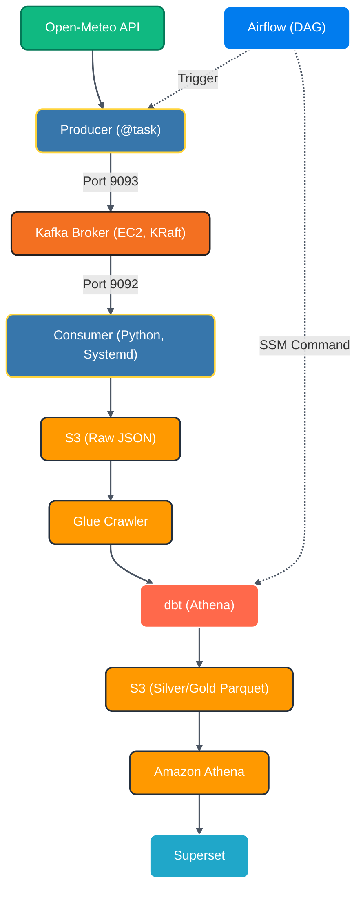

# AWS-Native Weather ETL Pipeline (Open-Meteo → Kafka → S3 → dbt → Superset)

A fully automated, end-to-end Data Engineering pipeline that ingests real-time weather data from the Open-Meteo API, streams it through Apache Kafka (hosted on AWS EC2), stores it in an S3 Data Lake, transforms it with dbt, and visualizes it in Apache Superset. 

The entire infrastructure is orchestrated by Apache Airflow, and the local demo can be launched with a single `./start.sh` command.

## Tech Stack

- **Ingestion:** Python, Apache Kafka (KRaft, EC2)
- **Orchestration:** Apache Airflow (Local Docker)
- **Storage (Data Lake):** AWS S3 (Raw JSON & Silver/Gold Parquet)
- **Catalog & Query:** AWS Glue, Amazon Athena
- **Transformation:** dbt (dbt-athena)
- **Visualization:** Apache Superset (Local Docker)
- **Infrastructure:** AWS EC2, Docker, Docker Compose, Systemd

## Architecture



## How to run

```bash
git clone <HTTPS/SSH/GitHub CLI Link>
cd AWS_native_open_meteo_ETL_pipline
chmod +x start.sh
./start.sh
```

The script will:

1) Generate temporary AWS STS credentials.

2) Start the EC2 instance (via AWS CLI) and wait for it to boot.

3) Inject the credentials into the Superset configuration.

4) Start Airflow and Superset via Docker Compose.

5) Automatically trigger the Airflow DAG to fetch new data and run dbt.

Once the script finishes, open:

Superset Dashboard: http://localhost:8088 (admin/admin)

Airflow UI: http://localhost:8080 (admin/admin)

## Architectural Decisions & Trade-offs

1. **Kafka on EC2 (not Docker locally)**: Chosen to demonstrate real-world cloud networking, Security Groups configuration, and managing a KRaft cluster on a constrained t3.small instance (including JVM memory tuning).

2. **dbt runs on EC2 (not locally)**: By running dbt on the EC2 instance, it uses the attached IAM Role to access Athena/S3. This avoids passing AWS access keys to the local machine.

3. **Superset runs locally (not on EC2)**: t3.small (2GB RAM) is too small to host Kafka, Airflow, and Superset simultaneously. Superset runs locally in Docker for the demo, connecting to Athena via temporary STS tokens.

4. **Glue Crawler**: Used to update the Glue Data Catalog with new S3 partitions. Runs as an Airflow task to ensure Athena always sees the latest data.

5. **Security**: The demo uses a dedicated user with minimal IAM permissions (Start/Stop, SSM, Athena). Temporary STS tokens are generated on-the-fly and injected into the pipeline. No long-lived AWS keys are stored in the repository.

## Limitations
1. **API Rate Limits**: The Open-Meteo API is free and occasionally returns 503 Service Unavailable. The pipeline is configured to skip failed requests and retry on the next scheduled run.

2. **Data Gaps**: Because the pipeline is on-demand and the EC2 instance is stopped to save costs, there may be gaps in the timeline (e.g., no data for days when the instance was off).

3. **Tested environment**: Linux (WSL 2 on Windows). Not tested on macOS (Apple Silicon/ARM64).

4. **Credentials**: The demo uses admin/admin for local Airflow and Superset. This is intentional for the local demo and should not be used in production.